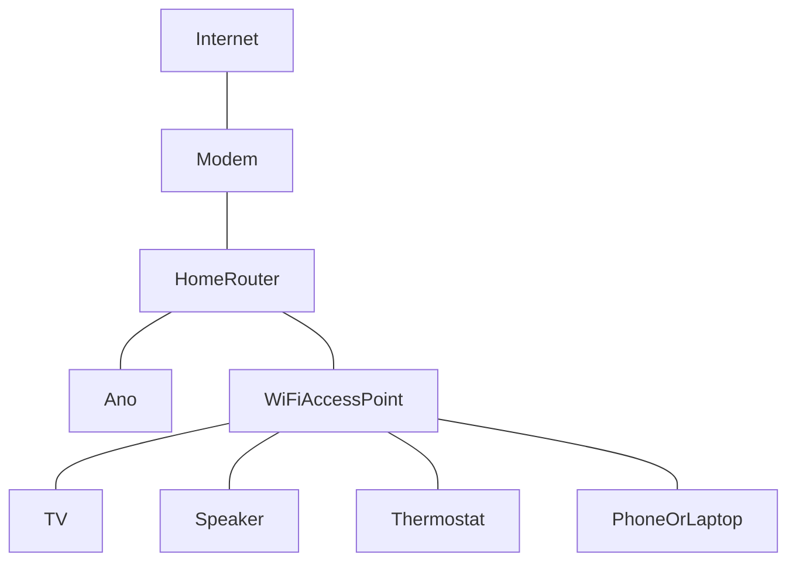
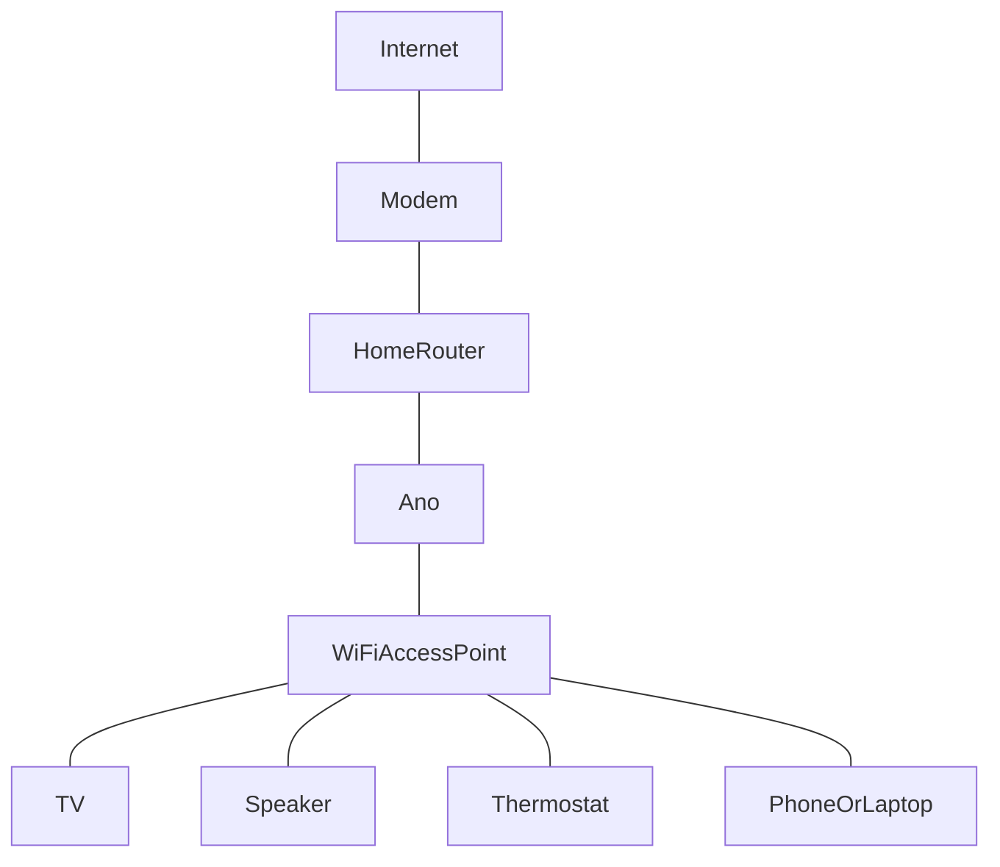
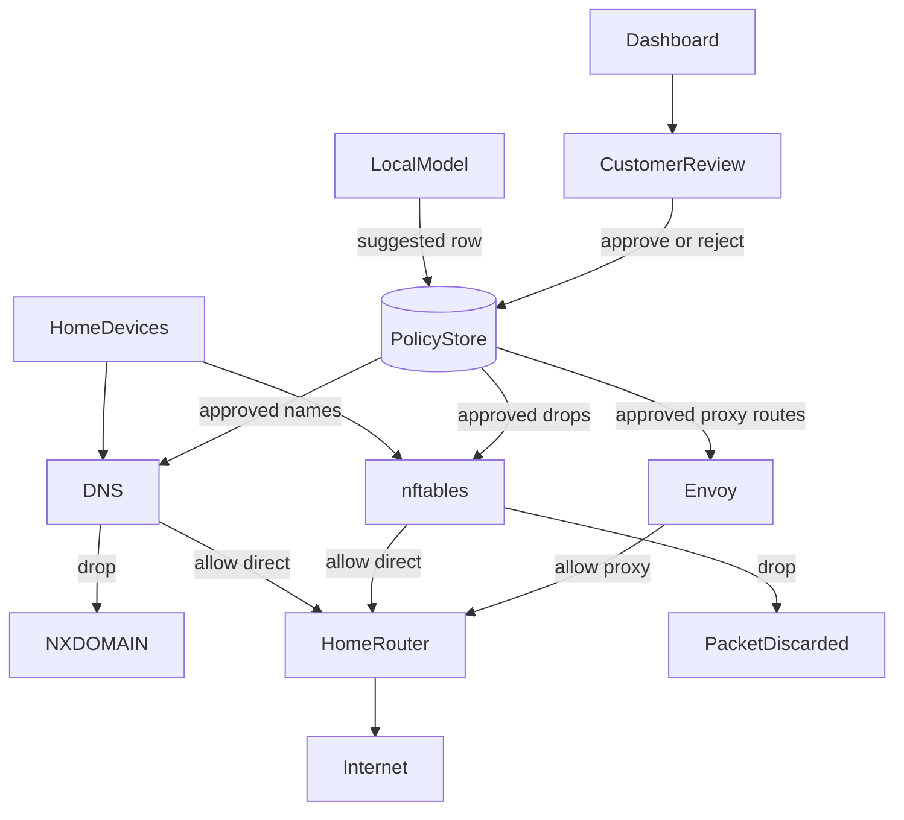
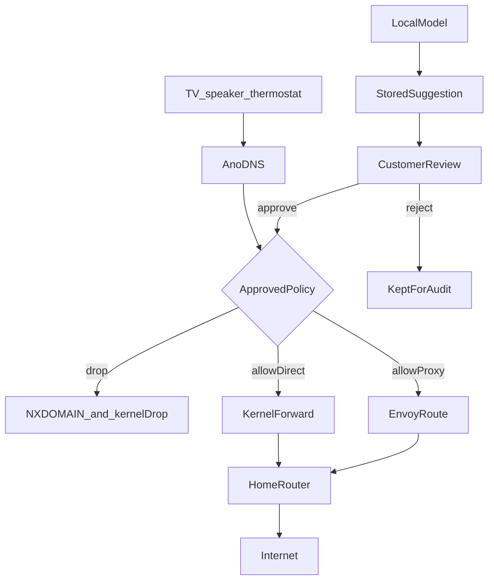
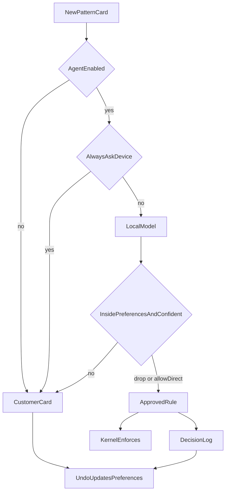
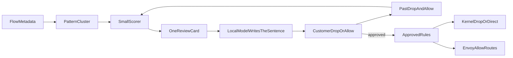

# Ano

Ano is a home privacy appliance. It sits in front of the path out of the house, answers DNS for TVs, speakers, and thermostats, and drops destinations the household has not allowed. A small model on the same box explains traffic patterns in household language. The household reviews those cards. Envoy carries only the routes that were explicitly allowed through the proxy.

This file is the saved plan. The proof of concept in this repository runs on the computer you are using (macOS or Linux). It does not need a Raspberry Pi. The Pi build below is the later always-on box.

## Proof of concept in this repository

The first runnable slice controls speaker traffic.

- Go process (`cmd/hbar`) is the advisor and the policy store. It runs on this machine. It writes one card per speaker pattern and does not enforce a suggestion by itself.
- The speaker-only switch is on by default. Turn it off to see other devices, such as the hall phone.
- Next.js review screen on port 4317. Drop, Allow directly, or Allow through Envoy.
- Envoy on port 10080 loads only approved `drop` and `allow_envoy` routes. Direct allows never enter Envoy. Suggested cards are absent from the Envoy config.
- Seeded speaker names, from public discussion of Echo telemetry: `device-metrics-us.amazon.com`, `device-metrics-us-2.amazon.com` (usage reports, suggested drop), and `avs-alexa-na.amazon.com` (voice assistant cloud, suggested allow, because dropping it stops spoken answers).

Nothing is blocked until you choose. Ask Envoy on an approved card to see the proxy answer.

## What Ano stops

Household devices leak by looking up vendor names and sending small regular uploads: TV automatic content recognition, speaker usage metrics, thermostat cloud check-ins. Ano's useful act is to refuse those destinations. It does not store speaker audio, viewing contents, thermostat readings, or any other payload. Keeping copies would be a second leak.

Cloud speakers and cloud thermostats are built to talk to their vendor. Dropping that core service stops the feature as well as the leak. Cards say which outcome you are choosing. Usage reports and spoken answers are separate cards.

DNS is the first gate. An approved drop answers NXDOMAIN. The kernel (nftables) is the real packet drop on the inline Pi, because many devices skip DNS with hardcoded addresses, DNS-over-TLS, or DNS-over-HTTPS. Envoy is the allow-via-proxy path only. On this proof of concept, Envoy also demonstrates a drop by answering 403, so you can see enforcement without being the house router.

TLS to the device is not the default. Terminating TLS requires the device to trust a certificate you install. Smart TVs, Alexa, Google speakers, and most thermostats pin certificates or have no way to add a CA. For those, the working control is drop or allow.

## Locked decisions

- The model never sits on the per-packet path. It runs when a pattern card is created.
- A suggestion does not change live routing. Your Drop or Allow does.
- Learning is labels in SQLite plus the advisor. The language model is not fine-tuned on household traffic.
- No cloud account and no cloud model API.
- No certificate-pin bypass.
- Firewall files are generated for you to apply. The app does not install nftables rules by itself.
- Metadata only.

## Home deployment

Two layouts. DNS works in the first. On-Pi kernel drops and real Envoy proxying require the second, because they only see packets that cross the Pi. The proof of concept uses the computer you are on, with Envoy as a local listener, which matches the second layout's policy without moving your access point yet.

### Beside the router

One Ethernet cable from the appliance to a LAN port. DHCP tells every device to use Ano for DNS. Other packets still go from the access point to the router. Hardcoded-IP drops are installed on the router from the exported rules.

Router checklist:

- DHCP DNS is Ano and only Ano.
- Block LAN clients from sending UDP/TCP 53 or 853 anywhere except Ano.
- Block well-known DNS-over-HTTPS addresses.
- Do not forward mDNS off the LAN.
- Keep the previous ruleset so a bad export can be restored.

### In front of Wi-Fi

The access point's uplink moves to Ano. A second Ethernet port faces the home router. Every device packet crosses Ano before the router.

### What runs on the box

Metadata retention defaults to 14 days and can be shortened. Deleting a card deletes its label. The appliance sends nothing to a vendor cloud.

## Hardware, when you leave the laptop

Buy a Raspberry Pi 5 with 16 GB. The CPU and RAM are soldered. A 4 GB board cannot hold a useful model next to DNS. An 8 GB board can run a 3B model with little memory left for the gateway.

- Raspberry Pi 5, 16 GB
- Official 27 W USB-C power supply
- Active Cooler
- M.2 HAT and a 256 GB or larger NVMe SSD
- A case that fits the cooler and the HAT
- Short Ethernet cable
- For the in-front-of-Wi-Fi layout: a second NIC or a USB gigabit adapter

Measured llama.cpp generation on a Pi 5 16 GB with an active cooler and NVMe (May 2026): about 11 tokens/s for a 1B Q4 model, about 4.4 tokens/s for Llama 3.2 3B Q4, about 2 tokens/s for an 8B Q4. A 1B–3B model is the right size. An 8B model is too slow beside DNS. A Hailo AI HAT does not speed up this kind of text generation.

A larger model is a second machine: an N100 or N150 barebones, 16 GB minimum and 32 GB when the board accepts it. Generation there is still a few tokens per second.

On the proof of concept, the advisor is the Go process on this computer (`hbar-speaker-advisor`). It fills the same role as the later on-box language model: classify the name, reuse past choices, write the sentence. Phase 2 replaces the sentence writer with llama.cpp. The decision rules stay.

## Phases

- **Phase 1, this repository.** Speaker cards, Drop and Allow, label memory, Envoy config from approved routes, the review UI. The advisor suggests. You decide.
- **Phase 2.** A local 1B–3B model writes the card sentence. Opt-in TLS origination in Envoy for devices that accept a household certificate. No pin bypass. DNS for the whole house, and nftables export you apply yourself.
- **Phase 3.** An optional local agent decides new cards by consulting that model, using preferences you already reviewed. It ships off. You turn it on only after accepting a written summary of patterns you drop, patterns you allow, and devices pinned to always ask. The thermostat is the default pin. The agent may answer `drop`, `allow_direct`, or `ask`. It may not choose `allow_envoy`. Low confidence stays a card. Undo stores a correcting label and the agent must not immediately repeat the undone decision. One local model call per new pattern. No per-packet call.

## Pattern cards

Flows fold into one pattern: device, destination family, rhythm, and whether bytes are mostly leaving. Eighty lookups of the same metrics name are one card.

Example:

- Device: Kitchen speaker
- Activity: usage reports
- Evidence: 84 small uploads today, about every 5 minutes
- If you drop: usage reports stop. Spoken answers are a separate card
- Suggestion: Drop

After a decision, that same device and destination do not ask again. A new device showing the same category gets one card, with your earlier choice as the suggestion.

## Policy behavior

- Unknown speaker name: open one card, suggest a drop, leave it unenforced.
- Same device and destination already decided: apply the stored decision.
- Phone or laptop you mark unrestricted: allow directly, still log it.
- Approved allow directly: forward, and do not put the name in Envoy.
- Approved allow through Envoy: Envoy routes it.
- Approved drop: NXDOMAIN on the real gateway, and a 403 from Envoy in this proof of concept so the choice is visible. On the inline Pi the packet drop itself stays in nftables.
- Rejected or undecided: absent from DNS, nftables, and Envoy.

## Products already on the market

None of these open encrypted TV or speaker sessions and strip personal fields.

- Firewalla: per-device rules, VLANs, DNS and server-name blocking. It does not decrypt.
- Pi-hole and AdGuard Home: DNS sinkholes. Devices can bypass them unless the router forces DNS.
- NextDNS and Control D: hosted filtering. The resolver sees every name.
- OPNsense or pfSense: IoT VLAN with default-deny egress.
- UniFi and GL.iNet: segmentation and DNS on the router.

Ano exists to keep the policy store, the household-language cards, and the later agent in the house.

## Out of scope

- Decrypting TVs, speakers, or thermostats that will not trust your certificate.
- Storing payloads, recordings, or credentials.
- Filtering devices the household does not own.
- A cloud account, or sending flow logs to a cloud model.
- Fine-tuning a language model on household traffic.
- The phase 3 agent deciding before you accept the preference summary, choosing a proxy allow, overriding an always-ask device, or being asked about each packet.
- Calling Envoy external authorization on every request.
- Putting plain drops or direct allows through Envoy on the real gateway. The proof of concept uses an Envoy 403 only so a drop is visible on this machine.

## How to resume

1. Read this file before changing the product.
2. Phase 1 is the Go processor, the Next.js screen, and Envoy for speakers.
3. Phase 2 starts when speaker cards, labels, and Envoy reloads work.
4. Phase 3 starts when a local language model can write a card sentence and the preference summary is built from real labels.
